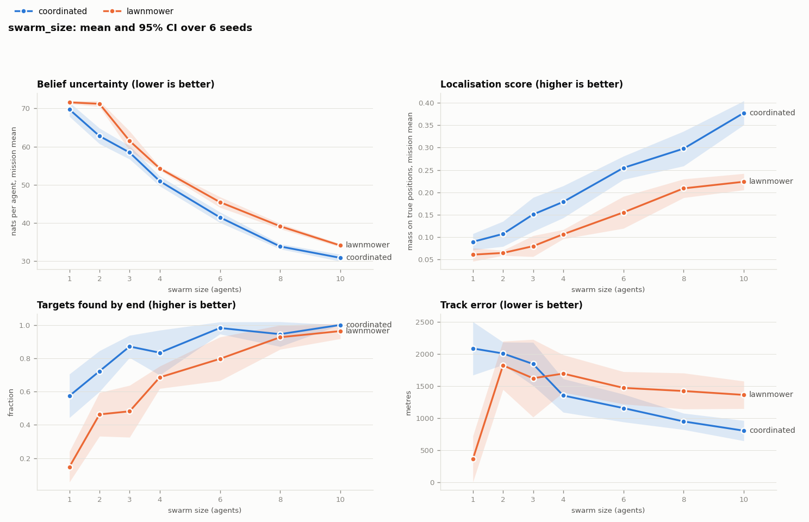

# geo-trackbot

A proof-of-concept simulation of **decentralised active search and terrain-constrained
tracking**. A small swarm of fixed-wing agents (3–10) searches an area for ground
vehicles, then keeps tracking them as they move. Each agent:

- holds its own belief about where vehicles are,
- fuses what it and its teammates observe,
- plans its own route to maximise expected information gain,
- coordinates only by sharing compact observation records and the route legs it has committed to.

There is no central controller.

Everything is in Python (numpy, scipy, matplotlib). There's no flight-dynamics
simulator and no autopilot integration. Sensing is idealised: anything inside an
agent's ground footprint is detected perfectly. The point of the POC is the
search, fusion, tracking and planning logic.

```
pip install -r requirements.txt
python -m geotrack run scenarios/s1_valley_search.yaml --animate     # run + MP4
python -m geotrack sweep sweeps/planners.yaml                        # Monte Carlo comparison
python -m pytest -q
```

---

## How it works

Each simulation step (default 5 s) runs this loop:

```
targets move ─► agents fly committed route ─► sense footprint ─► broadcast packet
     ▲                                                               │
     │        replan if leg finished or an event fired ◄── fuse ◄────┘
     └──────────────── (belief: search map + tracks) ◄───────────────┘
```

### 1. World (`geotrack/world.py`)
The world is a procedurally generated area, 10 km square at 50 m cells by default. It contains:
- fractal and ridged-noise terrain, plus optional *ridge walls* with passes,
- rivers,
- forest,
- a road network routed between towns and map exits along least-cost paths.

From slope and land cover the world derives **passability** (0 means impassable) and
**ground speed** per cell: fast on roads, slow in forest and on steep ground, zero
in water or on cliffs.

**Weather.** `world.wetness` runs from 0 (dry) to 1 (saturated). Wet ground:
- makes slopes impassable sooner,
- slows forest and off-road travel (at 0.9, mean off-road speed roughly halves),
- turns low ground near rivers to bog, which is impassable when saturated.

Roads are unaffected. The belief's prior and motion models use
`belief.assumed_wetness`, which defaults to the true value; set it differently to
test a belief working from out-of-date ground rules.

### 2. Targets (`geotrack/targets.py`)
Ground-truth vehicles follow simple rules:
- *road* vehicles drive shortest road routes between towns and exits, pausing at each,
- *off-road* vehicles take least-time cross-country routes, using roads where that is quicker,
- *static* vehicles stay parked.

Their motion is generated independently of the belief model, so the belief is never
tested against itself.

### 3. Sensing (`geotrack/agent.py`)
Each agent carries a circular ground footprint (250 m radius by default). Every
target inside it is detected with its exact position, heading, speed and ID.
Every step produces one **observation record**: footprint centre, radius, step and
detections, about 16 bytes plus 12 per detection. Detection probability `pd` is a
parameter, 1.0 by default.

### 4. Belief part 1: search map (`geotrack/belief.py`)
The search map holds the intensity of **not-yet-discovered** targets per cell, i.e.
the expected count.

- **Prior:** rules-based. Roads carry the most weight, then passable open ground;
  water and cliffs carry none.
- **Prediction:** a terrain-constrained advection–diffusion, implemented as a
  Metropolis Markov transition on grid cells:
  `P(i→j) = r_ij · min(1, π_j / π_i)`. Here `r_ij` is set by the ground speed of both
  cells and `π` is the prior.
  - The prior is therefore the stationary distribution. Ground that has been
    searched and emptied refills from its surroundings, along roads and through
    passes, back towards the prior.
  - In continuous form this is a Fokker–Planck (advection–diffusion) equation with
    drift up `∇log π`. That linear operator is the same one that would define the
    mean dynamics of a spatio-temporal Gaussian process with a physics-derived
    kernel. The filter here propagates **only the mean intensity**, not a
    covariance, so it is a Bayesian grid filter with GP-style dynamics, not a GP.
- **Update:** exact negative information. Inside a footprint any target would have
  been seen, so the intensity there is multiplied by `(1 − pd)`. Discovered targets
  leave this map and become tracks.

### 5. Belief part 2: tracks (`geotrack/tracking.py`)
Each discovered target gets a grid particle filter (600 particles).

- Particles follow a correlated random walk on the 8-connected grid. They keep
  their heading, move at the cell's ground speed, stay on roads when on a road, and
  can never enter impassable cells.
- So between sightings the cloud spreads *along roads and through passes*, not in
  circles.
- Footprints that saw nothing prune particles. This resolves branches: "we looked
  down the north road and it was empty, so it went south".
- If every hypothesis is ruled out, the track re-seeds over unobserved reachable
  ground.

### 5b. Observation effort and bias audit (`geotrack/audit.py`)
Agents do not look everywhere equally: they loiter over tracks and favour roads.
A map built only from detection counts therefore shows where the swarm *looked*
as much as where vehicles *were*.

Every record carries its footprint, so each agent keeps an exact
**observation-effort** layer (looks per cell) alongside its raw detection counts.
These are sums, so arrival order doesn't matter.

At the end of a run the **bias audit** (`bias_audit.png` and the `audit_*`
summary fields) compares four maps of vehicle activity against the true
time-averaged occupancy, aggregated to 500 m blocks:

| map | how it's built |
|---|---|
| naive | detection counts |
| effort-corrected | detections per look, shrunk towards the prior where effort is thin (8 looks per block, chosen by scanning 0.25–32) |
| prior only | the rules-based prior |
| truth | time-averaged true occupancy |

On S1 (6 seeds) the shape error against the truth (total-variation distance)
was 0.51 for the naive map, 0.47 effort-corrected and 0.63 for the prior alone,
with the coordinated planner (detections correlate with effort, ρ = 0.44). With
the lawnmower it was 0.75 naive and 0.58 corrected.

### 6. Order-independent fusion
Records from teammates arrive late, out of order, or not at all. Both the search map
and the tracks keep per-step snapshots. A late record triggers a rewind to the step
before it and a replay.

All randomness is seeded from (target, sighting step, step). The belief is
therefore a deterministic function of the *set* of records held, whatever order
they arrived in: two agents holding the same records hold identical beliefs.
`tests/test_core.py` checks this.

### 7. Planning (`geotrack/planner.py`)
At each replan the agent generates candidate routes by rolling out fixed-wing
kinematics (constant airspeed, turn-rate limit set by a 150 m minimum turn radius).
There are four kinds of candidate:
- a 5×5 fan of two-segment turn manoeuvres,
- pursuit of the highest-value regions of the belief,
- pursuit of each track's predicted position,
- the remainder of the current route.

By default (`planner.objective: entropy`), each candidate is scored by the
**expected reduction in total belief uncertainty** over a 5-minute horizon,
discounted by time:

```
  w_search · Σ_cells first swept  H(cell holds an undiscovered target)
+ w_track  · Σ_tracks  P(re-observe the target) · U(track)
```

- `H` is the entropy of the Bernoulli variable "this cell is occupied", with
  `P = 1 − exp(−λ)`. Perfect sensing removes it.
- `U(track)` is the uncertainty the track adds to the map: its particles are
  smoothed by one motion step and scored with the same per-cell entropy, minus
  the floor of a fresh sighting.

Because the advection–diffusion prediction regrows uncertainty in ground that
has been searched, reducing it drives both spreading out and revisiting.

The alternative `planner.objective: detections` scores
`E[new detections] · H(where an undiscovered target is) + Σ P(re-observe) · H(track)`,
with footprint-binned entropies. It favours the highest-intensity ground and
known vehicles, and concentrates agents (see *Mission weights* below).

**Total belief uncertainty** is the search map's per-cell entropy plus every
track's `U(track)`, in nats. It is reported as the `belief_uncertainty` metric. An
earlier version measured tracks with the raw particle histogram, which saturates
at `ln(#particles)`, so a lost track looked no worse than a blurred one; the
smoothed version keeps growing.

### 8. Decentralised coordination
Before scoring, an agent removes from its belief everything its teammates' **committed
legs** are expected to observe:
- intensity under their committed footprints,
- track particles they will fly over.

Only the next five legs (5 minutes, the whole horizon by default) count as
committed (`planner.commit_legs`). Two legs left 17% of agent pairs within 1 km of
each other; five legs cut that to 7–8%.

When an agent receives a plan it didn't know about when it planned, and the two
overlap, the earlier plan has right of way (ties go to the lower ID) and the later
planner yields and replans. There is no central allocator.

### 9. Replanning modes
| mode | when an agent replans |
|---|---|
| `open_loop` | only when its 5-minute route runs out |
| `per_leg` | every leg (1 minute, staggered across agents) |
| `event` | every leg, **and** immediately on events: a new target, lost contact with a teammate (heartbeat timeout), or a plan conflict |

### 10. Comms (`geotrack/comms.py`)
The radio model is a range-limited broadcast mesh with per-link packet loss and
optional blackouts. Every step each agent broadcasts one packet containing:
- a header,
- a version vector (which records it holds),
- a status table (last known position and plan version of every agent),
- whatever records or committed plans its recently heard neighbours lack.

Items not acknowledged within a few steps are re-sent. Status and records relay
multi-hop. Every byte is counted.

### 11. Metrics (`geotrack/sim.py`)
Every metric is measured against **ground truth**, identically for every planner:

| metric | meaning |
|---|---|
| `belief_uncertainty` | total uncertainty in the agent's belief map (nats, averaged over agents): search-map entropy plus each track's excess. Model-based, so read it together with `loc_score` |
| `loc_score` | headline metric: mean over all targets of the belief mass within 250 m of the true position (track particles if found, search intensity if not). 1 = every target pinned down |
| `found_frac` | fraction of targets seen at least once |
| `track_err_m` | mean distance of track particles from the true position |
| `staleness_s` | mean time since each target was last seen |
| `coverage` | fraction of the area observed at least once |
| `map_divergence` | mean pairwise L1 difference between agents' search maps (0 = identical) |
| `kbytes`, `packets`, `replans` | cumulative communication and planning load |

---

## Scenarios

| file | what it shows |
|---|---|
| `s1_valley_search.yaml` | 4 agents, 9 vehicles (6 road, 2 off-road, 1 parked) on ridged terrain with a river and road network. Baseline for comparisons. |
| `s2_degraded_swarm.yaml` | 6 agents, 50% packet loss, 3 km radio range, a 2-minute blackout, agents A1 and A4 lost mid-mission. Beliefs drift apart and re-converge; survivors re-spread once the lost agents' commitments time out. |
| `s3_terrain_funnel.yaml` | A steep ridge crossable only at two passes and by road; most vehicles drive cross-country. Shows what the terrain constraint buys. |
| `s4_wet_ground.yaml` | The S1 valley after heavy rain (wetness 0.9): floodplain bog, slow off-road going, two-thirds of vehicles cross-country. Compare with `--set belief.assumed_wetness=0`. |

Override anything from the command line:

```
python -m geotrack run scenarios/s1_valley_search.yaml --seed 3 \
    --set planner.type=greedy agents.count=6 comms.loss=0.4 --animate
```

All parameters and their defaults are in `geotrack/config.py`.

## Visualisation

`run --animate`, or `animate <run_dir>`, renders an MP4 (`--format gif` for GIF):

- **left:** terrain, roads, towns, true vehicles (filled once found), agents with footprints,
  committed routes, trails and live comms links.
- **right:** one agent's belief (`--agent N`). Blue is the expected number of
  undiscovered targets per cell; orange is track particles; × marks true
  positions for reference. Next to it are live metrics and the event log.
- **bottom:** localisation and found fraction, track error and data sent over time.

`--layout all` shows every agent's belief side by side, which is the best way to see
divergence under comms loss (S2). `--snapshot [frame]` writes a single PNG.

## Experiments

```
python -m geotrack sweep sweeps/planners.yaml       # coordinated vs isotropic vs greedy vs lawnmower
python -m geotrack sweep sweeps/terrain_model.yaml  # terrain-constrained vs isotropic belief (S3)
python -m geotrack sweep sweeps/replanning.yaml     # open-loop vs per-leg vs event-triggered
python -m geotrack sweep sweeps/resilience.yaml     # packet loss and agent loss (S2)
python -m geotrack sweep sweeps/replanning_degraded.yaml  # per-leg vs event-triggered under failures (S2)
python -m geotrack sweep sweeps/weather.yaml        # dry vs wet ground; weather-aware vs stale prior (S4)
```

Each sweep writes `runs/sweeps/<name>/` containing:
- `results.csv`: one row per run,
- `timeseries.csv`,
- `summary.md`: mean ± s.e. per variant,
- `timeseries.png` and `summary.png`.

### Results

These come from synthetic worlds with POC defaults. They show the mechanics work and
point in the expected directions; they are not performance claims. All runs are
30-minute missions; values are mean ± s.e. over seeds.

**Swarm size** (`sweeps/swarm_size.yaml`, S1, 6 seeds; current defaults)



| agents | uncertainty (nats), coordinated | uncertainty (nats), lawnmower | localisation, coordinated | localisation, lawnmower | found, coordinated | found, lawnmower |
|---|---|---|---|---|---|---|
| 1 | **69.7 ± 0.9** | 71.6 ± 0.2 | **0.09 ± 0.01** | 0.06 ± 0.01 | **0.57** | 0.15 |
| 2 | **62.8 ± 1.0** | 71.2 ± 0.4 | **0.11 ± 0.01** | 0.07 ± 0.00 | **0.72** | 0.46 |
| 3 | **58.5 ± 0.9** | 61.5 ± 1.3 | **0.15 ± 0.02** | 0.08 ± 0.01 | **0.87** | 0.48 |
| 4 | **51.0 ± 0.7** | 54.3 ± 0.2 | **0.18 ± 0.02** | 0.11 ± 0.01 | **0.83** | 0.69 |
| 6 | **41.5 ± 0.7** | 45.5 ± 0.7 | **0.26 ± 0.01** | 0.16 ± 0.02 | **0.98** | 0.80 |
| 8 | **33.9 ± 0.3** | 39.2 ± 0.4 | **0.30 ± 0.02** | 0.21 ± 0.01 | **0.94** | 0.93 |
| 10 | **30.9 ± 0.5** | 34.1 ± 0.2 | **0.38 ± 0.01** | 0.22 ± 0.01 | **1.00** | 0.96 |

- The coordinated planner leaves less uncertainty than lawnmower sweeps at every
  swarm size, even though lawnmowers cover more ground: at 4 agents it covers 52% of
  the area against 76%.
- Its localisation advantage *grows* with swarm size, from 1.5× at 1 agent to about
  1.7× at 10. Lawnmower strips stop helping once ground is covered, while the
  planner turns extra agents into tracking.
- For small swarms the planner finds far more vehicles: 57% vs 15% with one agent,
  because it searches roads first.
- Lawnmower track error at 1 agent (366 m) is a selection effect: it found only
  15% of vehicles, mostly ones it happened to pass repeatedly.

**Mission weights** (`sweeps/mission_weights.yaml`, S1, 4 agents, 6 seeds)

| planner | uncertainty (nats) | localisation | area covered | track error |
|---|---|---|---|---|
| uncertainty, w_track 1 (default) | **51.0 ± 0.7** | 0.18 ± 0.02 | 0.52 | 1356 m |
| uncertainty, w_track 4 | 51.6 ± 0.9 | 0.21 ± 0.02 | 0.45 | 1098 m |
| uncertainty, w_track 16 | 54.2 ± 1.3 | 0.25 ± 0.03 | 0.39 | 1014 m |
| detections objective | 54.3 ± 0.6 | **0.30 ± 0.02** | 0.38 | **916 m** |

Minimising total uncertainty and pinning down known vehicles pull in different
directions:
- Most of the map's uncertainty is unsearched ground, so the uncertainty
  objective sweeps.
- Localisation rewards staying on found vehicles, which the detection-driven
  objective does, at the cost of clustering agents near them.
- `w_track 4` is a cheap compromise: about +1 nat of uncertainty for +0.03 localisation.

The objective and weights are mission settings.

*The tables below were produced with the earlier defaults (detection-driven
objective, 2-leg commitments, 8 seeds). The comparisons within each table hold;
absolute numbers differ from the current defaults.*

**Planners** (`sweeps/planners.yaml`, S1, 4 agents)

| variant | localisation | targets found | track error | area covered | belief divergence |
|---|---|---|---|---|---|
| coordinated, terrain belief | **0.30 ± 0.02** | **0.85 ± 0.05** | **875 ± 104 m** | 0.35 | 0.007 |
| coordinated, isotropic belief | 0.10 ± 0.02 | 0.65 ± 0.06 | 1892 ± 230 m | 0.37 | 0.011 |
| greedy (myopic, uncoordinated) | 0.22 ± 0.02 | 0.78 ± 0.06 | 1067 ± 90 m | 0.36 | 0.040 |
| lawnmower | 0.11 ± 0.01 | 0.68 ± 0.05 | 1725 ± 113 m | **0.76** | 0.002 |

- Lawnmower coverage covers twice the area but localises targets worst.
  Coverage is not information.
- Coordinated planning beats myopic, uncoordinated planning on every target
  metric, and agents' maps stay about 5× more alike.

**Terrain constraint** (`sweeps/terrain_model.yaml`, S3, ridge and passes)

| belief / tracker | localisation | targets found | track error |
|---|---|---|---|
| terrain-constrained | **0.25 ± 0.02** | **0.76 ± 0.04** | **849 ± 64 m** |
| isotropic | 0.11 ± 0.01 | 0.62 ± 0.06 | 1857 ± 287 m |

The terrain constraint is the largest single effect measured. It more than doubles
localisation and halves track error, here and in S1.

**Replanning** (`sweeps/replanning.yaml` on S1; `sweeps/replanning_degraded.yaml` on S2)

| scenario | mode | localisation | track error | replans | kB / agent / min |
|---|---|---|---|---|---|
| S1 | open loop | 0.26 ± 0.02 | 995 ± 77 m | 28 | 1.82 |
| S1 | per leg | 0.29 ± 0.02 | 846 ± 140 m | 121 | 2.04 |
| S1 | event-triggered | 0.30 ± 0.02 | 875 ± 104 m | 147 | 2.11 |
| S2 (failures) | per leg | 0.29 ± 0.03 | 911 ± 129 m | 152 | 3.04 |
| S2 (failures) | event-triggered | 0.28 ± 0.01 | 861 ± 104 m | 202 | 3.12 |

Closed-loop replanning beats open loop. Event triggers on top of 1-minute
per-leg replanning made **no measurable difference** to localisation here, even
with failures; they did roughly halve belief divergence in S2 (0.024 vs 0.041). The
likely reason is that a 1-minute leg is already short compared with how fast
the picture changes. Event triggers should matter more with longer legs or
faster targets, which is a natural next experiment.

**Resilience** (`sweeps/resilience.yaml`, S2, 6 agents)

| condition | localisation | track error | belief divergence |
|---|---|---|---|
| 10% loss, no failures (reference) | 0.33 ± 0.03 | 686 ± 75 m | 0.018 |
| 0% loss + blackout + 2 agents lost | 0.30 ± 0.03 | 868 ± 73 m | 0.017 |
| 30% loss + blackout + 2 agents lost | 0.27 ± 0.03 | 889 ± 96 m | 0.023 |
| 60% loss + blackout + 2 agents lost | 0.30 ± 0.01 | 776 ± 67 m | 0.014 |

The swarm degrades gracefully. Losing a third of the agents plus a blackout costs
about 10% localisation, and up to 60% packet loss makes no clear further difference.
Resends and multi-hop relay keep beliefs close: divergence stays below 0.025.
Traffic stays at about 2.4–3.4 kB per agent-minute.


**Weather** (`sweeps/weather.yaml`, S4, two-thirds of vehicles cross-country)

| condition | localisation | targets found | track error |
|---|---|---|---|
| dry ground | 0.24 ± 0.02 | 0.81 ± 0.05 | 1058 ± 146 m |
| wet ground, belief knows | 0.24 ± 0.02 | 0.78 ± 0.03 | 974 ± 127 m |
| wet ground, belief assumes dry | 0.27 ± 0.01 | 0.78 ± 0.04 | 794 ± 108 m |

A negative result: **in this setup the weather-aware prior gives no measurable
benefit.** The stale dry-weather belief is no worse; its edge is within noise.

The models do differ as intended. The weather-aware belief puts 0.16 of the 9
expected vehicles on bog against 0.82, and predicts off-road speed of 2.0 m/s,
which matches the truth, against 3.9 m/s. Likely reasons it doesn't help:
- Bog covers little of where vehicles actually go.
- Over-estimating speed widens the track clouds, and the wider clouds absorb other
  model mismatches, such as route choice and stops.

A sharper test would make wetness change the *topology* of movement, for example
fords or valley floors that close when wet, rather than mainly its speed.

## Assumptions and limitations

- **Perfect sensing.** Detection inside the footprint is certain and gives true
  identity, so there is no data association, no false alarms and no confidence
  model. `agents.pd` (detection probability) is threaded through the belief
  updates, but nothing else about imperfect sensing is modelled.
- **No line-of-sight.** Terrain constrains where vehicles can go, not what agents can see.
- **Closed population.** No vehicles enter or leave the area. The search map is a
  Poisson intensity whose total is the expected number of undiscovered targets.
- **Non-evasive targets.** Vehicles do not react to the agents.
- **Kinematic agents.** Constant speed and altitude, turn-rate-limited 2-D flight,
  no collisions, no endurance limit.
- **The search map ignores its own motion inside the planning horizon.** Candidate
  routes are scored against the current intensity (tracks *are* forecast forward).
  This is a deliberate cost trade-off.
- **Snapshot window.** Records older than the rewind window (default 40 steps,
  about 3 minutes) are applied at the current time, approximately; these are counted
  in `SearchMap.approx_updates`.

## Layout

```
geotrack/
  config.py        defaults, YAML loading, dotted overrides
  world.py         terrain, land cover, roads, passability, grid helpers
  targets.py       ground-truth vehicle behaviour
  observations.py  observation records and per-agent record store
  belief.py        search map: advection-diffusion prediction, negative-information update, rewind
  audit.py         observation-effort bias audit
  tracking.py      terrain-constrained particle tracks
  planner.py       kinematic rollouts, information-gain scoring, greedy and lawnmower baselines
  agent.py         platform, sensing, gossip, events
  comms.py         lossy range-limited broadcast mesh
  sim.py           main loop, metrics, recording
  viz.py           animation and snapshots
  plots.py         sweep comparison plots
  sweep.py         Monte Carlo runner
scenarios/         scenario YAMLs
sweeps/            experiment YAMLs
tests/             unit and integration tests
```
